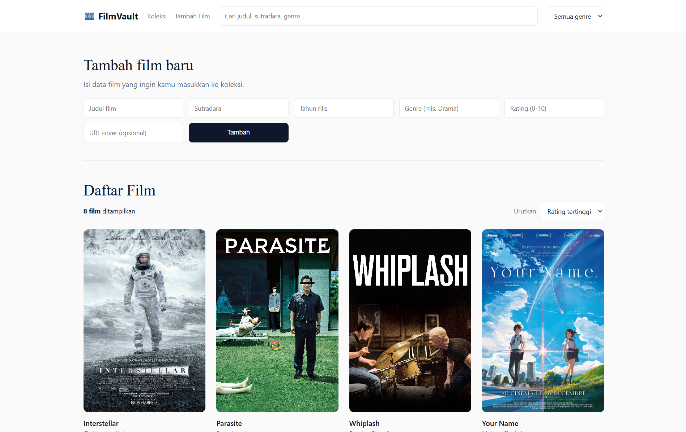

- **Nama:** (Muhammad Zaki)
- **NIM:** (103022400141)
- **Mata kuliah:** Pemrograman Web

# FilmVault — Katalog Film 

Aplikasi katalog film berbasis **React + Vite**. Project ini dikembangkan bertahap sepanjang semester sebagai kerangka aplikasi fullstack.

- **Tugas 6 (Bab 6 – React Dasar):** component, props, state, render list, form controlled, conditional rendering.

> Entitas data utama: **Film** (`judul`, `sutradara`, `tahun`, `genre`, `rating`, `cover`, `sinopsis`).

---

### Tugas 6

| Tahap | Screenshot |
|---|---|
| `npm run dev` di `localhost:5173` |  |

**Tugas 6**
- Enam component terpisah di `src/components/`
- Daftar film disimpan sebagai state (array) di `App.jsx`
- Render list dengan `.map()` dan `key` unik
- Form tambah film (controlled component) dengan tombol **Tambah**
- Conditional rendering: teks **"Belum ada data film"** saat daftar kosong
- Tambahan: pencarian, filter genre, pengurutan, dan slot gambar cover

---

### Ringkasan Component

| Component | Props | Fungsi |
|---|---|---|
| `Navbar` | `kataKunci`, `onUbahKataKunci`, `daftarGenre`, `genreAktif`, `onUbahGenre` | Navigasi, pencarian, filter genre |
| `FormTambahFilm` | `onTambah` | Form tambah film baru |
| `CariFilmAPI` | `onTambah`, `judulTersimpan` | Cari film dari TVMaze API |
| `DaftarFilm` | `daftarFilm`, `totalFilm` | Render list film + kondisi kosong |
| `KartuFilm` | `judul`, `tahun`, `genre`, `sutradara`, `rating`, `cover` | Kartu satu film |
| `Poster` | `cover`, `judul` | Gambar cover, fallback jika gagal dimuat |
| `Footer` | `namaApp` | Footer aplikasi |

---
